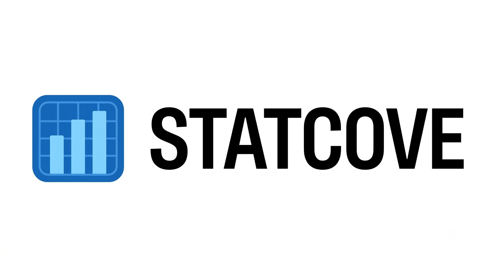

  <picture>
    <source media="(prefers-color-scheme: dark)" srcset="https://capsule-render.vercel.app/api?    type=venom&color=f03c45&fontColor=ffffff&height=300&section=header&text=Welcome%20&fontSize=90" />
    
  </picture>

## 🛠️ Tech Stack

  
  
  
  
  
  
  

## 🚀 Projects

<table>
  <tr>
    <td width="50%" valign="top">
      <h3></h3>
      
MLB 기록 탐색·비교·분석 데이터 플랫폼

      
<b>2026.09 ~ 현재 · 프론트 · 백엔드 · AWS 인프라</b>

      
<code>Java</code> <code>Spring Boot</code> <code>MySQL</code> <code>AWS</code> <code>Docker</code>

      
      
      
    </td>
    <td width="50%" valign="top">
      <h3>🗓️ 맞춰봄</h3>
      
모임 일정 조율 서비스

      
<b>2025.09 ~ 2025.12 · 백엔드 팀원</b>

      
<code>Java</code> <code>Spring Boot</code> <code>MongoDB</code>

      
      
      
    </td>
  </tr>
</table>

## Hi there 👋

- 🏫 Pursuing a bachelor's degree in Computer Science & Engineering at Kyonggi University, Korea
- ✅ Studying Server development and Database
- 🪪 Have a certification in SQL Developer, Engineer Information Processing (National Technical Qualification), CSTS and TOPCIT (632)
- 🔭 I'm currently working on STATCOVE project
- 🌱 I'm currently learning Spring AI
- 📫 How to reach me: daewon6905@gmail.com

## 📁 Publications

- 📄 Jo, H., Kim, S., Jeong, D., Oh, H., & Chung, K. (2025). Multilingual OTC Drugs Chatbot System Using Retrieval-Augmented Generation. *The Transactions of The Korean Institute of Electrical Engineers, 74*(11), 1972-1978. [10.5370/KIEE.2025.74.11.1972](https://doi.org/10.5370/KIEE.2025.74.11.1972)
